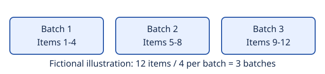

# Run the fictional Cosmos DB Sprocket mock locally

> FICTIONAL TEST FIXTURE: Sprocket is not a real Azure Cosmos DB feature.
> This original Learn-style exercise is not Microsoft Learn content and must
> not be used as Azure product guidance.

The fictional Sprocket mock helps developers practice reviewing technical
documentation. It calculates a batch count for imaginary items using local
integer arithmetic. It does not connect to Azure or modify a database.
This page documents fixture version 0.1; its authoritative source is
[the local specification](fixture-spec.md), maintained in this repository.

## What does the fictional Sprocket mock do?

Given an item count and batch size, the simulator returns the number of batches
needed: `(items + batch_size - 1) // batch_size`. For example, twelve items in
batches of four require three batches. This calculation does not create actual
batches or measure database performance.

## Prerequisites and supported inputs

Use Python 3.10 or later and run the command from this repository's root.
The simulator uses the standard library only; no installation, Azure account,
credentials, network access, or resource creation is required.

| Argument | Required value |
|---|---|
| `--items` | Integer from 1 to 1000, inclusive |
| `--batch-size` | Integer from 1 to 32, inclusive |

Both arguments are required. The mock has no `--mode` option.

## Calculate the batch count

Run the documented offline simulator:

```bash
python3 examples/sprocket/sprocket_demo.py --items 12 --batch-size 4
```

Expected output:

```json
{"feature": "fictional-sprocket", "items": 12, "batch_size": 4, "batches": 3, "network_calls": 0}
```

Verify that `batches` is `3`, `feature` is `fictional-sprocket`, and
`network_calls` is `0`. Read [the implementation](sprocket_demo.py) for the
exact argument checks. The example only calculates a result, so it requires
no resource cleanup.

## Understand the grouping



The diagram represents three groups: items 1-4, items 5-8, and items 9-12.
Each group has four items, so the arithmetic result is three batches. The SVG
is illustrative; the program returns counts rather than allocating these groups.
This textual explanation provides the important information without requiring
the image.

## Demo and accessibility

No video recording exists for this fictional fixture. Use
[the text-only walkthrough](walkthrough.md) for the command, expected result,
and verification steps. It is not a transcript of a real recording.
Do not treat the deliberately broken video in the bad example as evidence.

## Troubleshooting and limitations

An unknown option, missing argument, non-integer value, or out-of-range value
causes an argparse error and a nonzero exit status. Remove `--mode`, use the
documented ranges, and run again from the repository root. Do not substitute
Azure CLI or SDK commands for this local simulator.

The fictional Sprocket mock does not change Azure Cosmos DB queries, indexes,
RU charges, latency, availability, or scalability. No speedup or cloud
capability can be inferred from its batch count. Real product questions require
current authoritative Azure documentation, not this fictional exercise.
